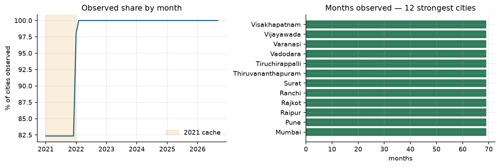
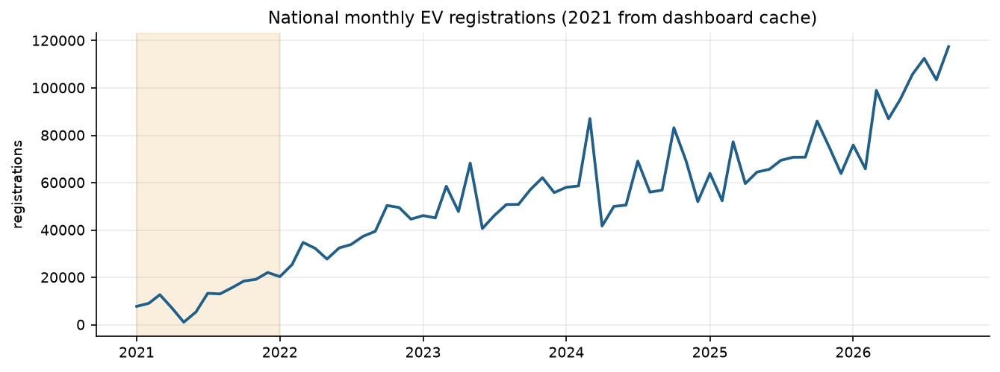
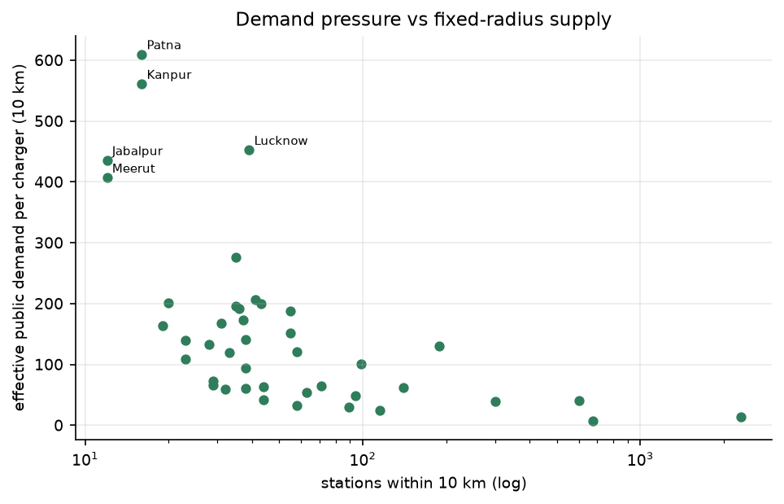
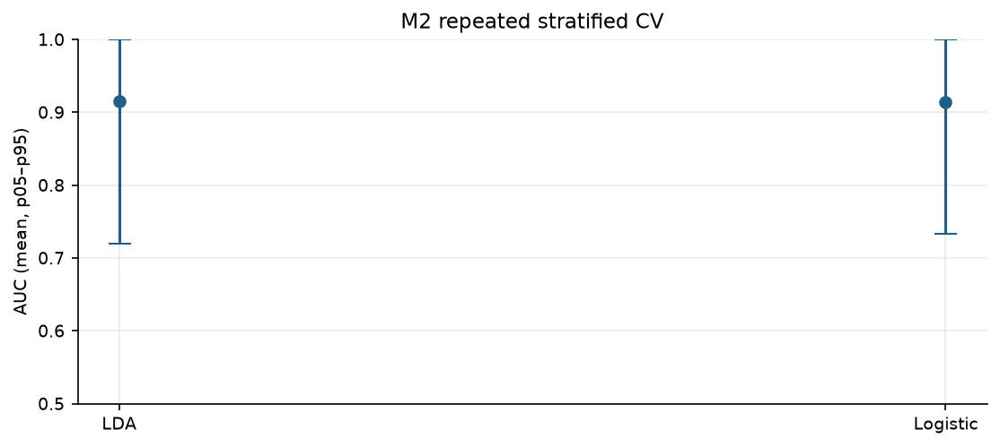
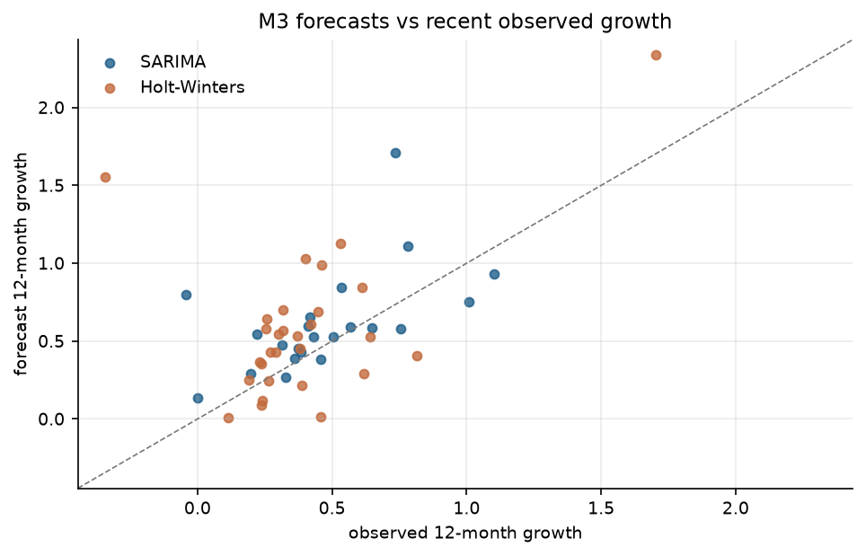
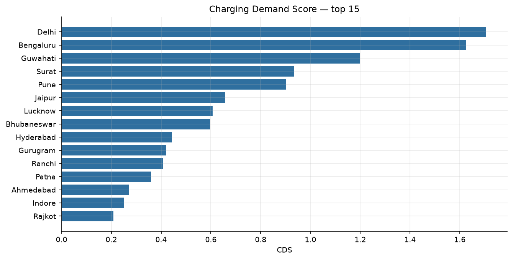

# EVision — EV charging demand and hotspot ranking

## Executive summary

EVision ranks 51 Indian cities by public charging demand. It combines a
2021–2026 city × month registration panel, charger counts at a fixed 10 km
radius, Census 2011 demographics, modelled petrol prices, state policy scores,
income and climate. The headline product is the Charging Demand Score (CDS),
which combines a count model, a classifier and a time-series forecast.

Key results:

- **3,519 city-months**, 51 cities, 2021-01 to
  2026-09; 96.9% observed.
- **M1 drivers:** non-EV market size is the strongest correlate
  (IRR 2.13, p < 0.001); income is
  negative (IRR 0.62) and policy is positive
  (IRR 1.28, provisional).
- **M2:** logistic AUC 0.914 and LDA
  0.915 under repeated 5-fold CV; the train–CV gap
  is about 0.06.
- **M3:** all 51 cities forecast; 22 SARIMA and
  29 Holt-Winters win their holdout. All fits are
  finite after scaling; no city is `unstable`.
- **CDS top five:** Delhi, Bengaluru, Guwahati, Surat, Pune. 2 cities are Critical and 3 High.
- **Robustness:** dropping the fuel price or the provisional policy score does
  not change the market-size and income findings. Dropping the seven unverified
  demographics raises M2 AUC to 0.977.

## 1. Problem and objectives

Public charging demand is not observed. A raw EV-per-charger ratio is misleading
because 2W mostly charge at home while 3W and 4W rely on public infrastructure.
The project therefore: (1) builds a weighted demand metric; (2) models adoption
drivers with a negative binomial; (3) classifies High/Low demand with logistic
and LDA; (4) forecasts 12-month growth with SARIMA/Holt-Winters; and (5)
combines them into a ranked CDS and an interactive map.

## 2. Data and provenance

| Input | Grain | Role |
|---|---|---|
| `registrations/vehicle-registrations-by-fuel-type.csv` | RTO × month × fuel | EV registrations (Electric(BOV) + Pure EV) |
| `registrations/registrations-by-vehicle-category.csv` | RTO × month × category | market size and 2W/3W/4W mix |
| `registrations/registrations-by-vehicle-class.csv` | RTO × month × class | transport vs non-transport |
| `supply/city_chargers.csv` | city | 15–30 km charger circle |
| `supply/stations_clean.csv` | station | fixed 5/10 km supply |
| `demographics/city_population_density.csv` | city | Census 2011 + 2023 estimate |
| `prices/city_month_petrol_51.csv` | city × month | fuel price |
| `policy/state_ev_policy_scores.csv` | state | policy score (provisional) |
| `geo/india_state.geojson` | state | choropleth |

2021 comes from cached dashboard responses (`panel_source = dashboard_cache`),
2022 onward from the Vahan export (`vahan_export`). Nine cities have no 2021
cache; their leading 12 months stay empty. The manifest records them, along with
the 109 unobserved rows and the 17 covariate-poor configured cities.

## 3. Cleaning and feature engineering

- Duplicate city-months are removed; the grid is reindexed so gaps are explicit.
- Gaps of at most two months are interpolated; longer gaps stay empty.
- IQR outliers are flagged per city and winsorised, never dropped
  (**72** flagged).
- Derived: cumulative stock, MoM/YoY growth, 3-month mean, market share, EV share
  of new sales, commercial share, fixed-radius supply, demand ratios.
- `master_ev_panel.csv` is the analysis-ready merge: **3,519 × 116**.

## 4. Objective 1 — effective public demand

`effective_public_demand = weighted_ev_stock / stations_within_radius`, where
weighted stock uses 0.15·2W + 0.70·3W + 1.00·4W + 0.60·COMM. The comparable
variant divides by `stations_10km` because the city circle radius varies 15–30 km.
42 cities have a measured split; 6 use a state proxy and 3 a national proxy.

## 5. Objective 2 — adoption drivers (negative binomial)

M1a is between-city (n=51); M1b is a panel with city fixed effects. The table
reports incidence-rate ratios from M1a.

| Term | IRR | p |
|---|---:|---:|
| log_non_ev_market | 2.13 | 1.33e-14 |
| log_income | 0.62 | 2.35e-05 |
| market_x_rto | 1.29 | 0.00674 |
| log_rto_count | 0.03 | 0.00853 |
| ev_policy_score | 1.28 | 0.0106 |
| mean_fuel_price | 1.02 | 0.0206 |
| share_fast_10km | 0.53 | 0.0378 |
| log_density | 0.88 | 0.317 |
| log_population | 1.04 | 0.692 |
| summer_max_temp_c | 1.0 | 0.887 |
| log_cpos_10km | 1.03 | 0.901 |
| highway_corridor | 0.99 | 0.93 |

The fuel price is mostly the Delhi series times a city ratio, so its coefficient
is not a causal price effect. Refitting without it leaves the market-size and
income coefficients essentially unchanged (`model_m1_sensitivity.csv`). Removing
the provisional policy score also leaves the sign and significance of market size
and income intact (`model_m1_policy_sensitivity.csv`).

## 6. Objective 3 — High/Low demand classifier

The label is the upper half of `effective_public_demand_10km`. Predictors are
exogenous only: density, income, fuel price, policy, corridor, temperature. EV
stock, charger counts and growth are excluded.

| Model | AUC mean | SD | p05–p95 | Accuracy | LOOCV | Train–CV gap |
|---|---:|---:|---|---:|---:|---:|
| LDA | 0.915 | 0.099 | 0.72–1.0 | 0.883 | 0.902 | 0.039 |
| Logistic | 0.914 | 0.095 | 0.733–1.0 | 0.871 | 0.902 | 0.052 |

Dropping the provisional policy score **improves** CV AUC to
0.922, which is
evidence that the provisional score adds noise. Restricting to the 44 verified
demographics raises AUC to
0.977.

## 7. Objective 4 — 12-month forecasts

All 51 cities are fitted. Each model is scored on a 9-month holdout; the winner
is refit on the full series and forecast 12 months. Series are scaled before
fitting to prevent the non-converged fits that previously produced forecasts
around 1e30.

| City | Winner | Last 12m | Forecast 12m | Growth | RMSE/level | Quality |
|---|---|---|---:|---:|---:|---|
| Guwahati | Holt-Winters | 14,543 | 48,516 | 2.336 | 0.028 | ok |
| Surat | SARIMA | 22,319 | 60,433 | 1.708 | 0.033 | ok |
| Gurugram | Holt-Winters | 3,238 | 8,269 | 1.554 | 0.090 | ok |
| Ranchi | Holt-Winters | 9,865 | 20,994 | 1.128 | 0.032 | ok |
| Rajkot | SARIMA | 8,300 | 17,504 | 1.109 | 0.046 | ok |
| Dehradun | Holt-Winters | 6,945 | 14,077 | 1.027 | 0.034 | ok |
| Jaipur | Holt-Winters | 30,456 | 60,656 | 0.992 | 0.045 | ok |
| Bhubaneswar | SARIMA | 36,036 | 69,492 | 0.928 | 0.037 | ok |
| Coimbatore | Holt-Winters | 10,769 | 19,891 | 0.847 | 0.021 | ok |
| Ahmedabad | SARIMA | 26,387 | 48,713 | 0.846 | 0.026 | ok |
| Delhi | SARIMA | 93,369 | 167,971 | 0.799 | 0.026 | ok |
| Madurai | SARIMA | 5,455 | 9,562 | 0.753 | 0.041 | ok |

Quality: 51 ok, 0 weak, 0
unstable. The 2022-only sensitivity changes forecast growth by a median of
0.033; the largest moves are
Bhopal +0.41, Guwahati -0.26, Rajkot -0.26.
The Dec-2021 → Jan-2022 seam flags 8 cities, led by Guwahati.

## 8. Objective 5 — Charging Demand Score

CDS = 0.4·z(M1 expected monthly) + 0.3·P(high) + 0.3·z(M3 growth). A forecast
only enters the score when `forecast_quality = ok`; otherwise observed growth is
used and `m3_source` says so.

| Rank | City | CDS | Recommendation |
|---:|---|---:|---|
| 1 | Delhi | 1.706 | Critical — immediate fast-charger deployment |
| 2 | Bengaluru | 1.625 | Critical — immediate fast-charger deployment |
| 3 | Guwahati | 1.198 | High — prioritise in the next wave |
| 4 | Surat | 0.934 | High — prioritise in the next wave |
| 5 | Pune | 0.901 | High — prioritise in the next wave |
| 6 | Jaipur | 0.656 | Moderate — monitor and plan |
| 7 | Lucknow | 0.608 | Moderate — monitor and plan |
| 8 | Bhubaneswar | 0.597 | Moderate — monitor and plan |
| 9 | Hyderabad | 0.444 | Moderate — monitor and plan |
| 10 | Gurugram | 0.420 | Moderate — monitor and plan |
| 11 | Ranchi | 0.406 | Moderate — monitor and plan |
| 12 | Patna | 0.359 | Moderate — monitor and plan |
| 13 | Ahmedabad | 0.272 | Moderate — monitor and plan |
| 14 | Indore | 0.252 | Moderate — monitor and plan |
| 15 | Rajkot | 0.208 | Moderate — monitor and plan |

Weight sensitivity (top-15 membership):

| Perturbation | Overlap | Entered | Dropped |
|---|---:|---|---|
| m1 -0.10 | 14/15 | Gwalior | Indore |
| m1 +0.10 | 14/15 | Nagpur | Rajkot |
| m2 -0.10 | 15/15 | - | - |
| m2 +0.10 | 13/15 | Gwalior, Raipur | Ahmedabad, Rajkot |
| m3 -0.10 | 13/15 | Nagpur, Raipur | Gurugram, Rajkot |
| m3 +0.10 | 15/15 | - | - |

The interactive map is `reports/cds_map.html`.

## 9. Robustness and limitations

- **Fuel price** is modelled for most cities; M1 is shown with and without it.
- **Policy scores** are provisional for all 30 states. The rubric columns are
  blank and **0** states are verified. The BEE policy host was unreachable from
  the build environment, so the PDFs could not be read;
  `scripts/verify_policy_scores.py` produces an evidence table where it is
  reachable.
- **Seven cities** use municipal boundaries rather than urban agglomerations;
  their populations are verified but M1/M2 are still shown with and without them.
- **2021 seam:** 8 cities move by more than 1.5× into 2022; the 2022-only M3
  sensitivity is reported above.
- **Chargers** are a single snapshot; no monthly supply series exists.
- 17 of 68 configured cities lack city-level covariates and are excluded from the
  panel; 9 of the 51 analysed cities lack 2021 data.
- `n=51` is small for a classifier; report the CV spread, not a single AUC.

## 10. Recommendations

1. Verify the 7 demographic rows against Census UA tables before quoting
   density-driven results; if they cannot be verified, use the 44-city model.
2. Read the policy PDFs and fill the rubric with cited snippets; until then,
   treat the policy coefficient as provisional.
3. Use the fixed 10 km supply measure for comparisons; never compare the
   variable-radius circle counts.
4. Treat the 2021 seam as a source boundary and prefer the 2022-only forecast for
   cities flagged in `seam_2021_2022.csv`.
5. Deploy against the top 15 shortlist (`cds_ranking_top15.csv`), not the full
   51-city ranking.

## Appendix — output map

- `data/processed/master_ev_panel.csv` — analysis-ready city × month table.
- `data/processed/cds_ranking.csv` / `cds_ranking_top15.csv` — full and shortlist.
- `data/processed/model_m1_*`, `model_m2_*`, `model_m3_*` — model outputs.
- `reports/cds_map.html` — interactive map.
- `reports/seam_2021_2022.csv` — seam diagnostics.
